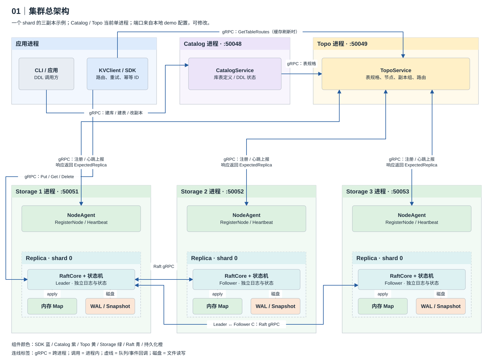
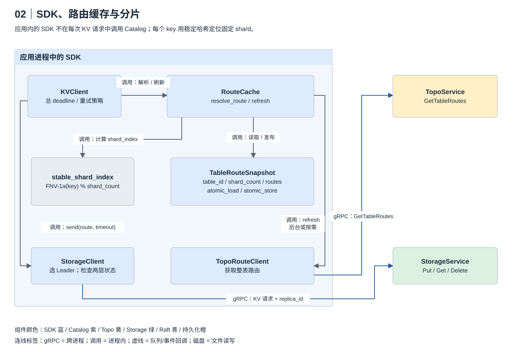
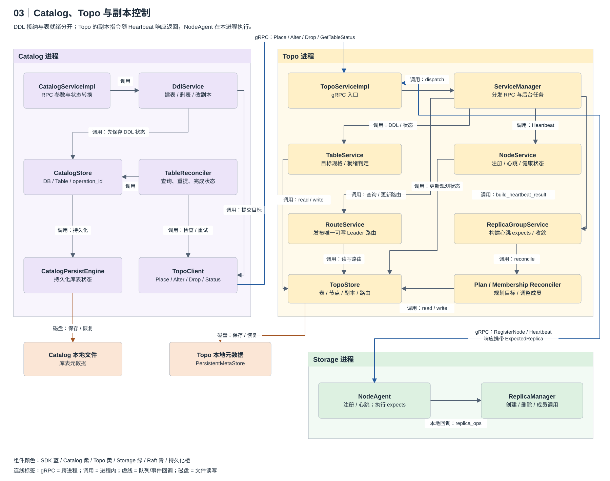
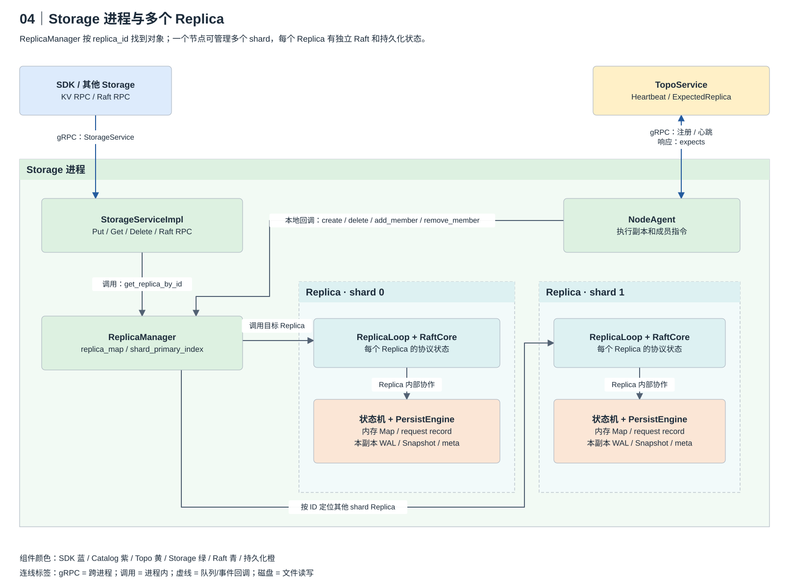
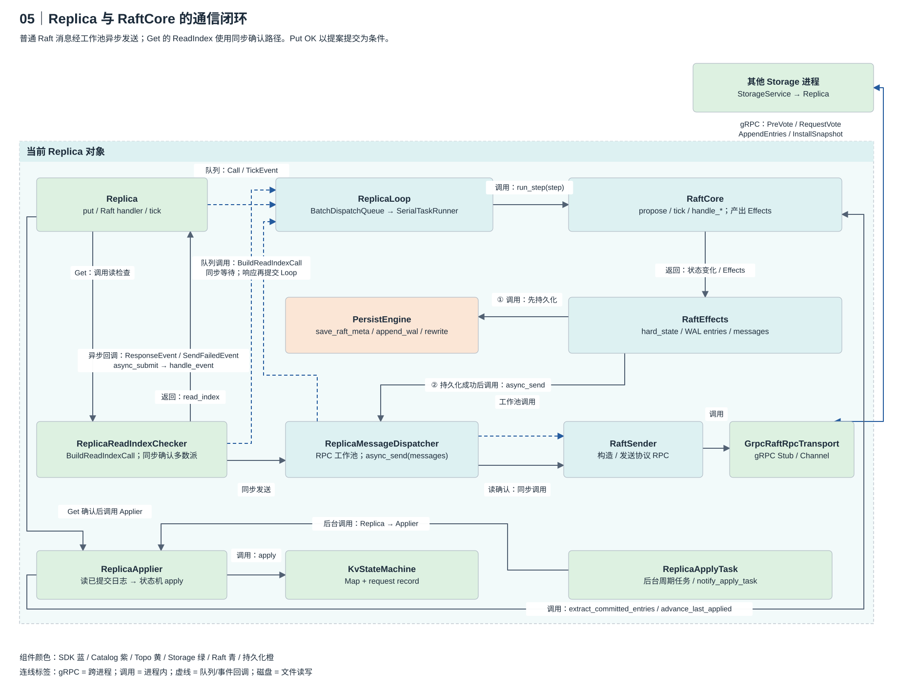
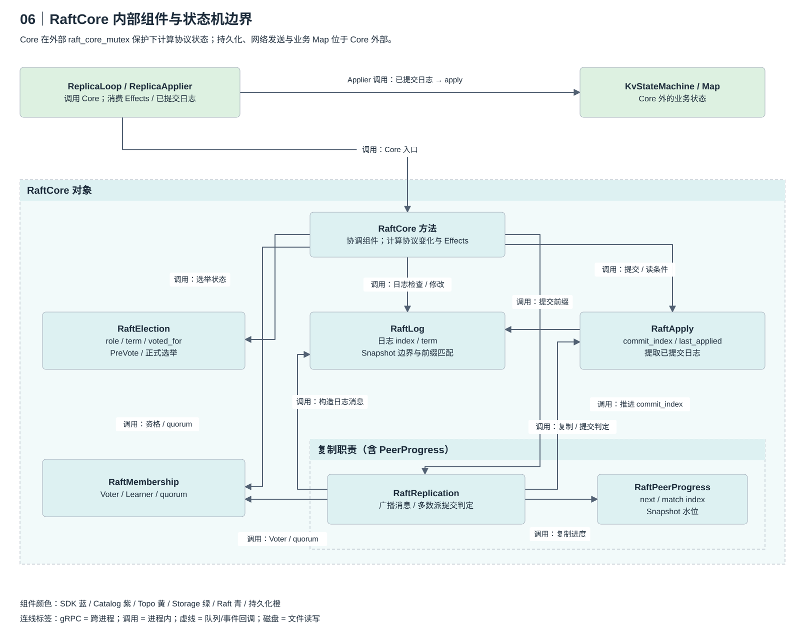
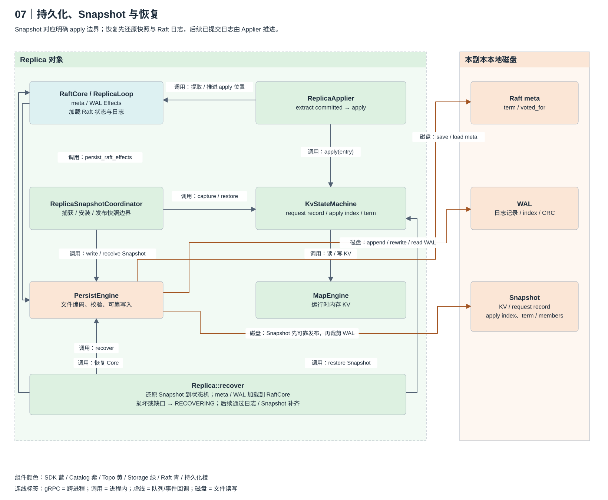

# 00｜组件架构：谁持有谁，谁调用谁

这 7 张架构图先回答组件之间的关系，再接到原有 19 张流程图。实线按标签区分进程内调用、gRPC 和磁盘读写；虚线表示队列提交或事件回调。大容器是进程，带虚线边框的内层容器是对象或内部职责分组。图中的 Storage 角色和端口是可变化、可配置的示例。

每节都提供可编辑的 drawio 源文件，SVG 自身也嵌入相同图源，可在 diagrams.net 中打开。推荐按 **A1 → A4 → A5** 先理解整体和 Storage，再展开其他专题。

## A1｜集群总架构

[编辑图源](../../assets/interview-architecture/01-cluster.drawio)

**怎么讲**：应用调用 Catalog 做 DDL，SDK 从 Topo 获取表路由并直接请求 Storage Leader。每个 Storage 用 NodeAgent 注册和上报心跳，Topo 在响应里返回期望副本指令。一个 shard 的 Leader 分别向各 Follower 复制；每个 Replica 都有自己的 Map、WAL 和 Snapshot。

**记住边界**：图中的三副本属于同一 shard；一个 Storage 进程也可以放其他 shard 的 Replica。图中的 Leader 会随选举变化。Catalog/Topo 当前是单进程，图里的本地端口来自 `conf/`，不代表固定部署协议。

**接着看**：[流程图 1–2：总览与分片](01-总览与分片.md)。**题库**：Q1–2、7、29–30、37、52。**源码**：[SDK](../../../src/sdk/client.cpp)、[Catalog DDL](../../../src/catalog/service/ddl_service.cpp)、[Topo 路由](../../../src/topo/service/route_service.cpp)、[Storage 启动与装配](../../../src/storage/main/main.cpp)。

## A2｜SDK 与分片

[编辑图源](../../assets/interview-architecture/02-sdk-sharding.drawio)

**怎么讲**：KVClient 管总超时和重试，调用 RouteCache 解析路由。RouteCache 调用稳定哈希辅助函数，读取整表快照得到 shard 路由；刷新时通过 TopoRouteClient 拉取新快照，再原子发布。KVClient 把选出的 route 交给 StorageClient，后者选择 Leader 并发 RPC。

**记住边界**：稳定哈希只计算 key 的 shard index；`table_id` 标识所属表。StorageClient 同时检查 gRPC 传输状态和业务状态。后台刷新和错误触发刷新都可以更新缓存，不需要每个 KV 请求都访问 Topo。

**接着看**：[流程图 2](01-总览与分片.md)、[流程图 7–8：重试与幂等](03-读写与SDK.md)。**题库**：Q9、15、17、19–24、27–30。**源码**：[KVClient](../../../src/sdk/client.cpp)、[RouteCache](../../../src/sdk/route_cache.cpp)、[TopoRouteClient](../../../src/sdk/topo_route_client.cpp)、[StorageClient](../../../src/sdk/storage_client.cpp)。

## A3｜建表与副本控制

[编辑图源](../../assets/interview-architecture/03-control-plane.drawio)

**怎么讲**：Catalog 的 DdlService 先通过 CatalogStore 记录目标与状态，再通过 TopoClient 提交。TableReconciler 持续查询、重提并更新完成状态。Topo 的 ServiceManager 分发到 Table、Node、Route、ReplicaGroup 服务，各服务读取或更新 TopoStore；副本组规划与成员 reconciler 推进目标收敛。

**记住边界**：Heartbeat 请求上报实际状态，Heartbeat 响应携带 `ExpectedReplica`。NodeAgent 的 `replica_ops` 是 Storage 启动时绑定的本地回调：创建、删除及成员调用进入 ReplicaManager；成员变更定位本节点的 Leader Replica 后进入 Raft。图中省略了后台任务类的四条定时触发线，任务实际通过 ServiceManager 调用各 reconcile 入口。

**接着看**：[流程图 3–5：建表、就绪与改副本](02-建表与副本.md)。**题库**：Q3、31–37、48、85、91。**源码**：[Catalog reconciler](../../../src/catalog/background/table_reconciler.cpp)、[Topo ServiceManager](../../../src/topo/service/service_manager.cpp)、[副本组服务](../../../src/topo/service/replica_group_service.cpp)、[Topo 后台任务](../../../src/topo/background/background.h)、[NodeAgent](../../../src/storage/node_agent/node_agent.cpp)。

## A4｜Storage 内部架构

[编辑图源](../../assets/interview-architecture/04-storage.drawio)

**怎么讲**：KV RPC 和 Raft RPC 都进入 StorageServiceImpl。Handler 根据 `replica_id` 从 ReplicaManager 找到目标 Replica，再调用对应的 `put/get/handle_*`。NodeAgent 也使用这个 Manager 管理副本。每个 Replica 独立持有 Loop、Core、状态机和持久化组件。

**记住边界**：图中每个 Replica 内的两个框是职责概览，不表示 RaftCore 直接调用 Map 或写磁盘；准确的调用方向看 A5/A7。Manager 提供对象查找，协议处理发生在 Replica 内；同一节点不能同时放同一 shard 的两个 Replica。

**接着看**：[流程图 6：Put](03-读写与SDK.md)、[流程图 10：Raft 部件](04-Raft.md)。**题库**：Q4、10、12、29、52。**源码**：[RPC Handler](../../../src/storage/handler/storage_service_impl.cpp)、[ReplicaManager](../../../src/storage/replica/replica_manager.cpp)、[Replica](../../../src/storage/replica/replica.cpp)、[启动装配与回调](../../../src/storage/main/main.cpp)。

## A5｜Replica 与 RaftCore 的通信闭环

[编辑图源](../../assets/interview-architecture/05-replica-raft-communication.drawio)

**怎么讲**：Replica 提交 Call 或 TickEvent 到 ReplicaLoop；提案和成员调用进入批量提交队列，其他同步 Call 或异步事件进入串行任务。Loop 调用 Core 计算 Effects，在 `run_step` 中先持久化 meta/WAL，再把消息交给 Dispatcher。普通消息经 RPC 工作池 → RaftSender → GrpcRaftRpcTransport 发出，响应或发送失败转成事件，通过 `async_submit` 回到 Loop 再处理。

**Get 的特殊路径**：ReadIndexChecker 同步提交 `BuildReadIndexCall` 得到当前任期和 read index，再通过 Dispatcher 的同步接口确认多数派；响应仍提交到 Loop 处理。检查成功返回 Replica 后，`Replica::get` 驱动 Applier 追到安全位置再读取。后台 ReplicaApplyTask 也会驱动 Applier。

**记住边界**：普通发送与读确认共用 Sender/Transport，但读确认不经过普通消息的工作池。RaftCore 在外部锁保护下计算状态；网络等待不在 Core 内执行。Put 等待提案提交后可返回 OK，apply 可以随后完成。

**接着看**：[流程图 6、9：Put/Get](03-读写与SDK.md)、[流程图 11–12：选举与复制](04-Raft.md)。**题库**：Q4–5、10、13、39–46、53。**源码**：[Loop 的 Call/Event 与执行](../../../src/storage/replica/replica_loop.cpp)、[Dispatcher](../../../src/storage/replica/replica_message_dispatcher.cpp)、[RaftSender](../../../src/storage/raft/raft_sender.cpp)、[gRPC Transport](../../../src/storage/raft/grpc_raft_rpc_transport.cpp)、[ReadIndexChecker](../../../src/storage/replica/replica_read_index_checker.cpp)。

## A6｜RaftCore 内部组件

[编辑图源](../../assets/interview-architecture/06-raft-core.drawio)

**怎么讲**：Core 方法协调 Election 的角色与任期、Log 的前缀与快照边界、Membership 的 Voter/Learner 集合，以及 Replication 的复制动作。Replication 使用 PeerProgress 跟踪每个节点的 next/match index，按 Voter 多数派推进 RaftApply 的 commit index。Applier 从 Core 取已提交日志，业务 Map 在 Core 外执行。

**记住边界**：日志新旧检查和投票资格判断由 Core 组合这些状态完成，Election 不直接持有 Log 或 Membership。RaftApply 管协议层的提交/应用位置，KvStateMachine 管业务值、去重记录和自己的应用位置。

**接着看**：[流程图 11–16：Raft 专题](04-Raft.md)。**题库**：Q39–44、46、48–52。**源码**：[RaftCore 成员与接口](../../../src/storage/raft/core/raft_core.h)、[RaftReplication](../../../src/storage/raft/raft_replication.cpp)、[RaftPeerProgress](../../../src/storage/raft/raft_peer_progress.cpp)、[RaftMembership](../../../src/storage/raft/raft_membership.cpp)、[RaftApply](../../../src/storage/raft/raft_apply.cpp)。

## A7｜持久化与恢复

[编辑图源](../../assets/interview-architecture/07-persistence-recovery.drawio)

**怎么讲**：Loop 通过 PersistEngine 写 Raft meta 和 WAL；Applier 读取已提交日志，调用状态机更新 Map 与 request record。SnapshotCoordinator 捕获明确应用边界的状态、读取成员信息，再通过 PersistEngine 保存快照；可靠发布后才能裁剪覆盖的日志。恢复时先恢复 Snapshot 的业务状态，再把 meta/WAL 装回 Core，后续已提交日志由 Applier 推进。

**记住边界**：每个 Replica 的文件独立，Map 是运行时内存引擎。WAL 有损坏或索引缺口会进入 RECOVERING，继续通过 Raft 日志或 Snapshot 补齐；加载文件成功不等于已经能安全服务。图中磁盘线的 save/load 标签表示读写职责，恢复数据先经过 PersistEngine。

**接着看**：[流程图 17–19：持久化与恢复](05-持久化与恢复.md)。**题库**：Q53–61、89–90。**源码**：[Replica 恢复](../../../src/storage/replica/replica.cpp)、[Applier](../../../src/storage/replica/replica_applier.cpp)、[状态机](../../../src/storage/raft/state_machine/kv_state_machine.cpp)、[SnapshotCoordinator](../../../src/storage/replica/replica_snapshot_coordinator.cpp)、[PersistEngine](../../../src/storage/persist/persist_engine.cpp)。
