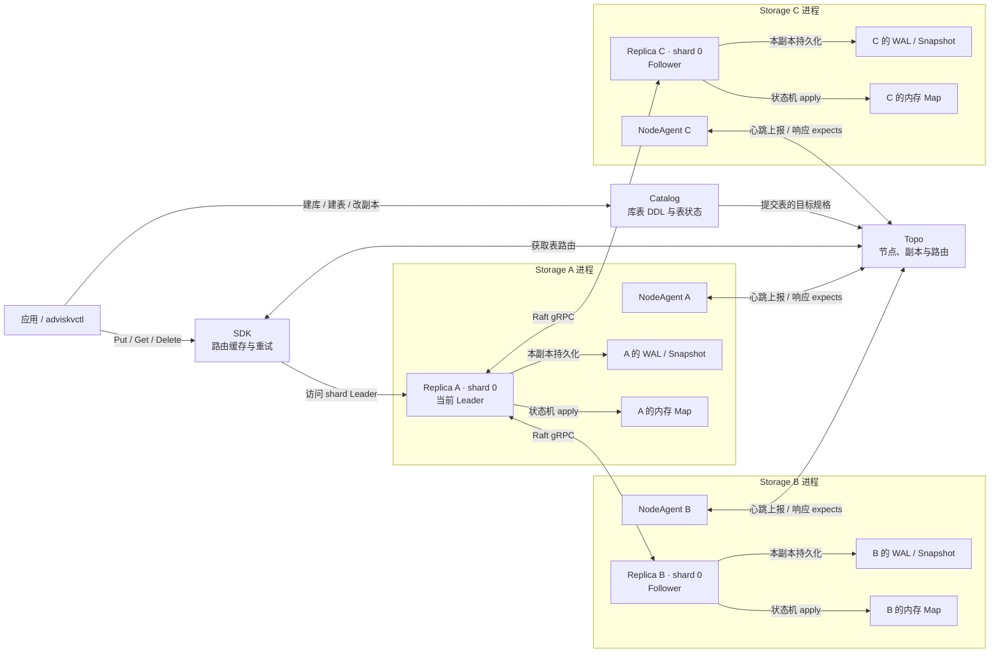
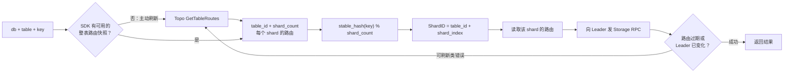

# 01｜总览与分片

按[图解目录](README.md)的顺序阅读；每张图先遮住“口述主线”自己讲一遍，再核对[题库](../分层面试题库.md)。图中的箭头表示职责或主要调用方向，不代表每次请求都经过所有模块。

## 图 1：系统总架构

**口述主线**：Catalog 管“要建什么表”，Topo 管“副本应该在哪、当前路由是什么”，Storage 管单个 shard 的复制与恢复；SDK 用路由找到 Leader。控制面推进目标状态，数据面处理读写。

嵌套布局和详细接口见[组件架构 A1](00-组件架构.md)。上图是同一 shard 的三副本示例，Replica 内部通过 Loop、Applier、PersistEngine 等组件分别执行复制、应用和持久化。

**易错点**：Catalog 和 Topo 当前各是单进程；Raft 复制的是 Storage 的 shard，不能说整个控制面都由 Raft 保证高可用。KV 运行时在内存 Map，WAL/Snapshot 用于恢复。

**题库**：[1–2、7、37](../分层面试题库.md)；**源码**：[Catalog DDL](../../../src/catalog/service/ddl_service.cpp)、[Topo 路由](../../../src/topo/service/route_service.cpp)、[Storage Replica](../../../src/storage/replica/replica.cpp)、[SDK](../../../src/sdk/client.cpp)。

## 图 2：从 key 到 shard Leader

**口述主线**：SDK 缓存 Topo 返回的整表路由快照，用稳定哈希把 key 映射到 shard，再取该 shard 的 Leader；冷启动无路由或遇到指定错误时刷新。Topo 和 SDK 都使用同一个 `stable_shard_index` 算法。

**易错点**：`table_id` 用来标识 shard 所属表，不参与当前 key 哈希。分片数在建表时固定；直接改 `shard_count` 会重映射已有 key，项目尚无在线 split/rebalance。

**题库**：[9、17、19–20、27、29–30、36、38](../分层面试题库.md)；**源码**：[稳定哈希](../../../src/common/stable_hash.h)、[SDK 路由缓存](../../../src/sdk/route_cache.cpp)、[Topo 路由服务](../../../src/topo/service/route_service.cpp)。
