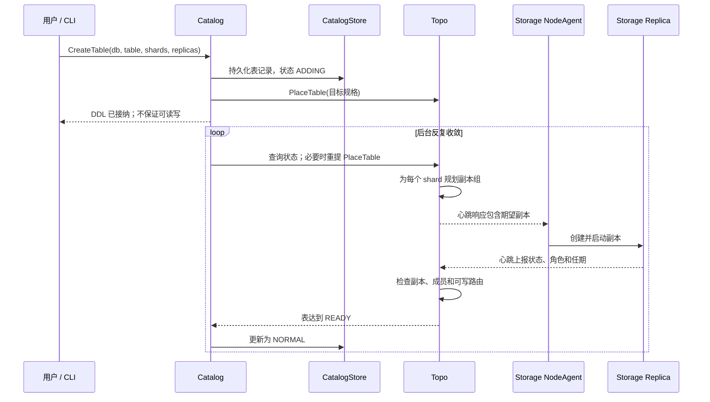
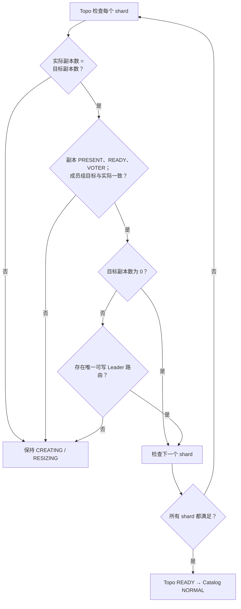
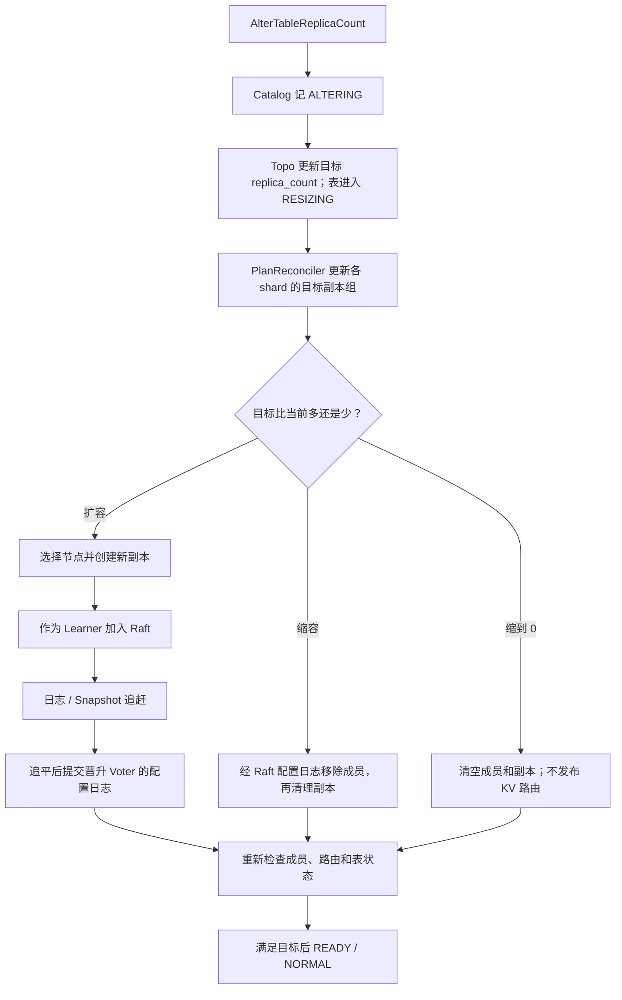

# 02｜建表与副本

这三张图区分“DDL 已接纳”“Topo 正在收敛”和“表可用”。对应的[题库](../分层面试题库.md)可按图号练习。

## 图 3：建表从接纳到就绪

**口述主线**：Catalog 先保存 `ADDING`，再向 Topo 交付目标；Topo 规划副本，Storage 通过 NodeAgent 执行，心跳反馈实际状态。后台 reconciler 可在 Topo 暂不可用时重试，最终满足条件才变为可用。

**易错点**：建表 RPC 返回 OK 不等于副本创建成功，也不等于路由存在。图中的后台循环表示多轮检查，内部步骤不保证在一轮里全部完成。

**题库**：[3、31–32、85、91](../分层面试题库.md)；**源码**：[DDL](../../../src/catalog/service/ddl_service.cpp)、[Catalog reconciler](../../../src/catalog/background/table_reconciler.cpp)、[Topo 表服务](../../../src/topo/service/table_service.cpp)、[NodeAgent](../../../src/storage/node_agent/node_agent.cpp)。

## 图 4：表 READY 的判定

**口述主线**：Topo 分 shard 检查目标数量、实际副本的 READY/VOTER 状态、成员组一致性，以及非零副本表的可写 Leader 路由；全部满足才标为 READY，Catalog 随后更新为 NORMAL。

**易错点**：`replica_count=0` 是受支持的目标状态，此时跳过可写路由检查；表的管理状态 READY 不代表能做 KV 读写。

**题库**：[3、32、34、85](../分层面试题库.md)；**源码**：[Topo 就绪判定](../../../src/topo/service/table_service.cpp)、[路由判定](../../../src/topo/service/route_service.cpp)、[Catalog 收敛](../../../src/catalog/background/table_reconciler.cpp)。

## 图 5：在线调整副本数

**口述主线**：先持久化目标副本数，再由 Topo 和 Storage 分轮推进。扩容先让 Learner 追赶，达标后通过 Raft 配置变更升为 Voter；缩容也需通过 Raft 变更成员，最终再看实际状态是否收敛。

**易错点**：Topo 改了目标值并不等于 Raft 成员立即改变；Learner 不计入 quorum。“在线”不承诺故障期间零失败。缩到零后没有可用 KV 路由。

**题库**：[32–35、48、85、90](../分层面试题库.md)；**源码**：[Topo 表规格](../../../src/topo/service/table_service.cpp)、[副本组规划](../../../src/topo/reconcile/replica_group_plan_reconciler.cpp)、[成员收敛](../../../src/topo/reconcile/replica_group_membership_reconciler.cpp)、[Raft 成员变更](../../../src/storage/raft/core/raft_core_append.cpp)。
