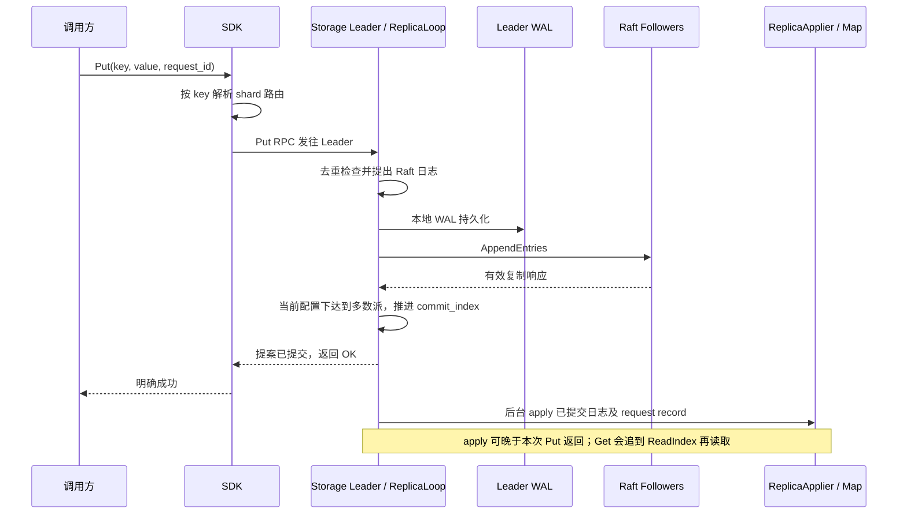
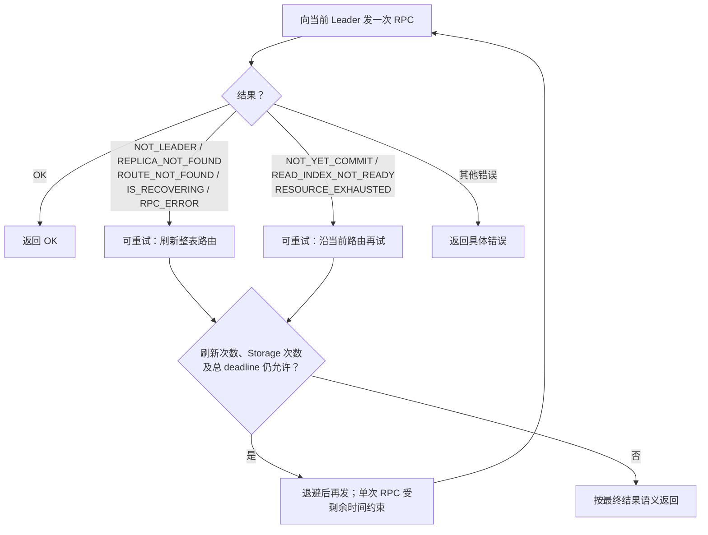
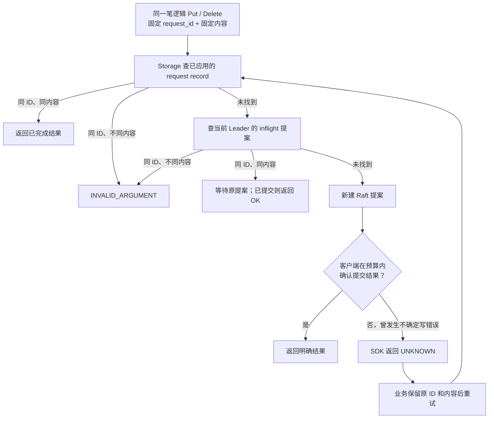
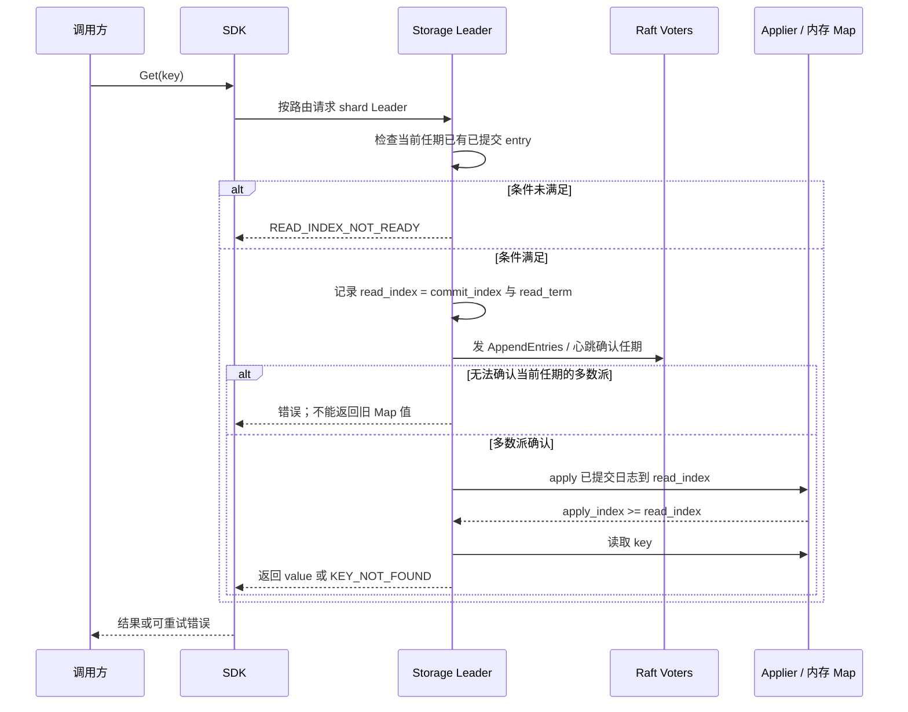

# 03｜读写与 SDK

先分别记住写的提交点和读的安全点，再用[题库](../分层面试题库.md)解释失败分支。

## 图 6：Put 的四个完成点

**口述主线**：SDK 定位 Leader，ReplicaLoop 去重并提议；持久化层先写 Leader WAL，再发送 Raft 消息。多数派确认后推进提交位置并唤醒 Put 等待者；后台 applier 把已提交日志写入 Map 和 request record。

**易错点**：本地 WAL 成功不等于多数派提交；当前代码的 Put OK 以提交为条件，**不等待本次状态机 apply**。若超时，后续仍可能提交，不能断言失败。

**题库**：[4、21、40、45、53、66](../分层面试题库.md)；**源码**：[SDK 请求](../../../src/sdk/client.cpp)、[Replica::put](../../../src/storage/replica/replica.cpp)、[提案完成条件](../../../src/storage/replica/replica_loop.cpp)、[状态机应用](../../../src/storage/replica/replica_applier.cpp)。

## 图 7：SDK 如何决定重试和刷新路由

**口述主线**：错误分成“可能是路由失效”和“当前节点暂时未就绪”两类；前者刷新 Topo 路由，后者保留路由重试。Storage 尝试次数、刷新次数和总 deadline 各有限额。

**易错点**：不是所有错误都能重试，也不是每次重试都查 Topo；对写请求，只有曾出现 `RPC_ERROR` 或 `NOT_YET_COMMIT` 时，预算耗尽才由 SDK 归为 `UNKNOWN`。

**题库**：[15、19–21、24、28、86](../分层面试题库.md)；**源码**：[错误分类与重试](../../../src/sdk/client.cpp)、[SDK 配置](../../../src/sdk/config.h)、[路由缓存](../../../src/sdk/route_cache.cpp)。

## 图 8：`request_id`、去重与 `UNKNOWN`

**口述主线**：SDK 为逻辑写生成或接受 `request_id`，重试不换 ID；Storage 先查已应用记录，再查 inflight，最后才新提议。记录进入状态机和 Snapshot，以便恢复后去重。

**易错点**：`UNKNOWN` 表示客户端无法确认结果，写可能已提交；一次普通 Get 不能普遍证明原写是否提交。`request_id` 记录当前无 TTL，同 ID 换内容会报错。

**题库**：[14、21–23、45、78、93](../分层面试题库.md)；**源码**：[SDK request ID](../../../src/sdk/client.cpp)、[Storage 去重](../../../src/storage/replica/replica_loop.cpp)、[状态机记录](../../../src/storage/raft/state_machine/kv_state_machine.cpp)。

## 图 9：Get 的 ReadIndex 安全读路径

**口述主线**：旧 Leader 可能仍自认是 Leader，因此读前需要当前任期已提交条目，再向多数派确认身份。取得 read index 后，Replica 先让状态机追到该位置，再读 Map。

**易错点**：ReadIndex 不是纯本地读，也不要求这次 Get 写一条业务日志；项目未实现 Lease Read 或开放 Follower 陈旧读 API。多数派不可达时不能声称总能读到值。

**题库**：[5、25、46–47、67、88](../分层面试题库.md)；**源码**：[Raft 读入口](../../../src/storage/raft/core/raft_core_read.cpp)、[多数派确认](../../../src/storage/replica/replica_read_index_checker.cpp)、[Replica::get](../../../src/storage/replica/replica.cpp)。
