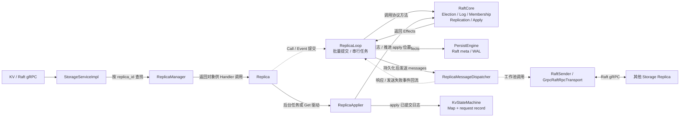
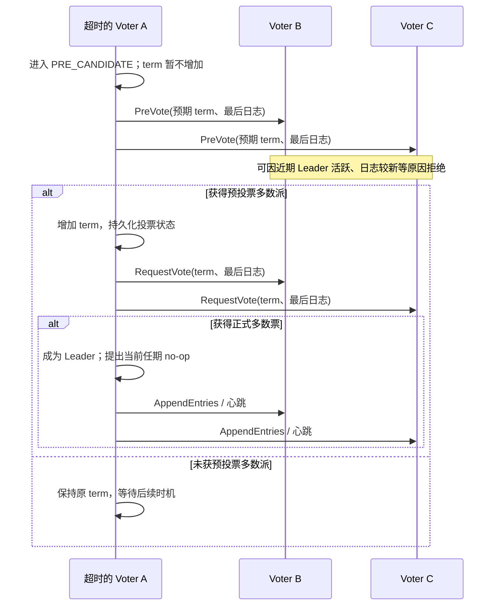
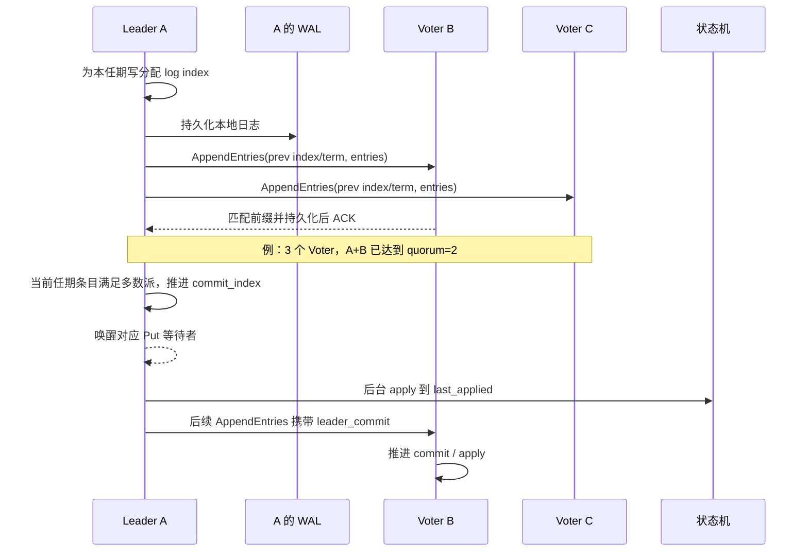
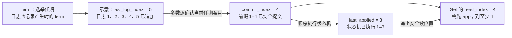
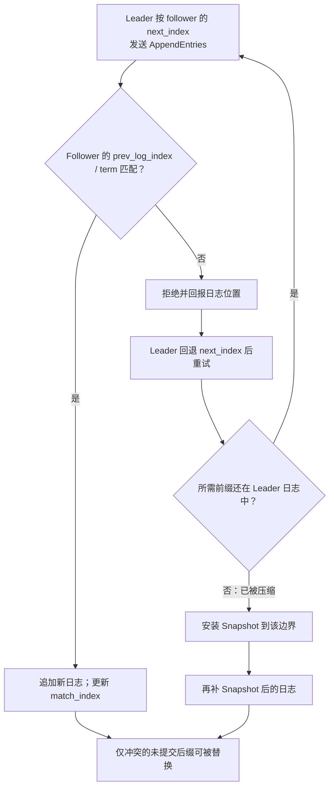
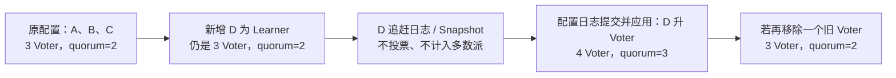
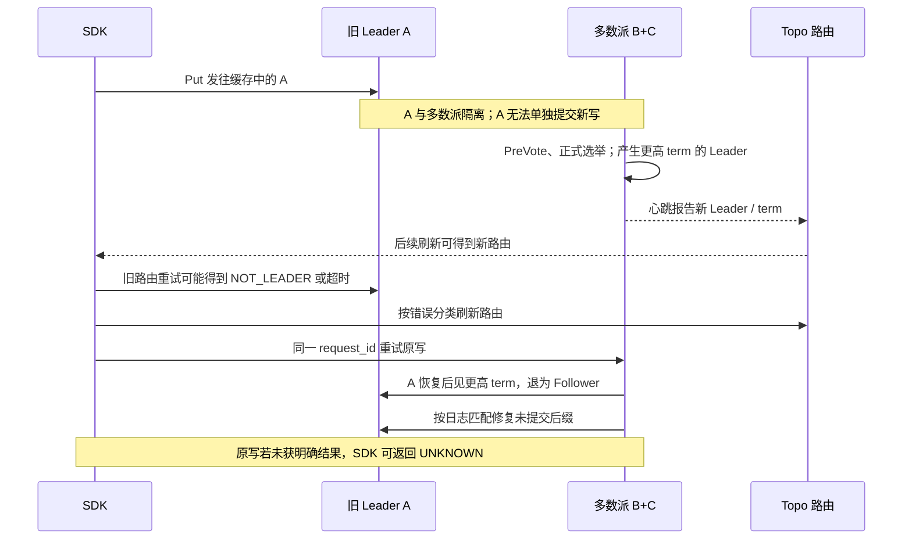

# 04｜Raft：从选主到故障切换

这七张图对应[题库的 Raft 部分](../分层面试题库.md)。先讲清单个 shard 的协议状态，再把它接到 SDK 和 Topo。

## 图 10：一个 Storage Replica 内的 Raft 部件

**口述主线**：RaftCore 决定角色、日志、复制和提交状态，并产出待持久化及待发送的 Effects；ReplicaLoop 处理这些 Effects。已提交日志由 Applier 送入状态机，SnapshotCoordinator 管快照边界和安装。

完整的同步读确认、异步事件回流和 Core 内部关系见[组件架构 A4–A7](00-组件架构.md)。上图中 Manager 负责对象查找，Handler 调用返回的 Replica；RPC 不会跳过 Replica 直接调用 RaftCore。

**易错点**：RaftCore 不是直接对磁盘写 KV；一个 shard 对应一个 Raft 组，不同 shard 之间没有自动事务。

**题库**：[10、39–40、52、63](../分层面试题库.md)；**源码**：[RaftCore](../../../src/storage/raft/core/raft_core.h)、[ReplicaLoop](../../../src/storage/replica/replica_loop.cpp)、[RaftApply](../../../src/storage/raft/raft_apply.cpp)、[状态机](../../../src/storage/raft/state_machine/kv_state_machine.cpp)。

## 图 11：PreVote、正式选举与新 Leader

**口述主线**：先 PreVote 探测能否获多数派支持，再增加 term 发正式 RequestVote；候选者还要通过日志新旧检查。新 Leader 提出本任期 no-op，为提交旧任期前缀和 ReadIndex 的当前任期条件建立位置。

**易错点**：PreVote 本身不选出 Leader，也不提升接收者的 term；只有当前 Voter 的正式多数票才可当选。PreVote 降低旧节点恢复时的扰动，不保证零切主时间。

**题库**：[39、41–42、44、49](../分层面试题库.md)；**源码**：[选举流程](../../../src/storage/raft/core/raft_core_election.cpp)、[选举状态](../../../src/storage/raft/raft_election.cpp)、[集群测试](../../../test/storage/raft/core/raft_cluster_test.cpp)。

## 图 12：日志复制、多数派提交与应用

**口述主线**：Leader 记录复制进度，按当前 Voter 集合计算多数派；当前任期条目满足提交条件后推进 commit index，随后各副本按顺序 apply。Follower 通过后续消息获知 `leader_commit`。

**易错点**：Follower 收到日志、本地 WAL 写入、多数派提交和状态机 apply 是四个不同位置。旧任期条目不能仅因 Leader 观察到多数副本持有它就直接宣布提交。

**题库**：[4、40–41、44、48、53](../分层面试题库.md)；**源码**：[复制与提交](../../../src/storage/raft/raft_replication.cpp)、[Append 处理](../../../src/storage/raft/core/raft_core_append.cpp)、[提交与应用](../../../src/storage/raft/raft_apply.cpp)。

## 图 13：term 与三个 index 不要混淆

**口述主线**：term 回答“哪个任期”，log index 回答“日志写到哪里”，commit index 回答“安全提交到哪里”，last applied 回答“状态机执行到哪里”。一般有 `last_applied ≤ commit_index ≤ last_log_index`。

**易错点**：图中的 3、4、5 是教学示例，不是仓库运行时的固定值。读条件看 `read_index` 和状态机 apply 位置，不能只看最新日志是否存在。

**题库**：[40–41、46、53、55](../分层面试题库.md)；**源码**：[RaftApply](../../../src/storage/raft/raft_apply.cpp)、[读索引](../../../src/storage/raft/core/raft_core_read.cpp)、[日志](../../../src/storage/raft/raft_log.cpp)。

## 图 14：冲突日志如何修复

**口述主线**：AppendEntries 用前一条日志的 index/term 校验共同前缀；不匹配时 Leader 调整 `next_index` 重试。若缺失日志已被快照压缩，先安装 Snapshot，再继续补尾部日志。

**易错点**：不能直接覆盖已提交前缀；安装 Snapshot 不代表已经追到 Leader 最新提交位置。

**题库**：[43、49、57、90](../分层面试题库.md)；**源码**：[Append 处理](../../../src/storage/raft/core/raft_core_append.cpp)、[复制进度](../../../src/storage/raft/raft_peer_progress.cpp)、[Snapshot 选择](../../../src/storage/raft/raft_replication.cpp)。

## 图 15：Learner、Voter 与 quorum 的变化

**口述主线**：新副本先以 Learner 跟上数据，再经 Raft 配置日志晋升；多数派按已生效的 Voter 集合算。三副本多数派为 2，四副本多数派为 3，所以 3→4 并没有增加可容忍的故障数。

**易错点**：Topo 的目标副本数不是当前 Raft 成员配置；Learner 不参与选举或写入 quorum。配置变更不能只改元数据而绕过 Raft。

**题库**：[33、44、48、90](../分层面试题库.md)；**源码**：[RaftMembership](../../../src/storage/raft/raft_membership.cpp)、[成员提案](../../../src/storage/raft/core/raft_core_append.cpp)、[Topo 成员收敛](../../../src/topo/reconcile/replica_group_membership_reconciler.cpp)。

## 图 16：Leader 故障与旧 Leader 回归

**口述主线**：多数派侧选出新 Leader 后继续提交；隔离的旧 Leader 不具备提交能力。旧节点回来时接受更高 term，并按新 Leader 的日志修复未提交后缀；SDK 刷新路由且保持原 request ID。

**易错点**：路由不是写入许可，Raft 多数派才决定是否提交。故障切换不保证每个客户端请求零失败；Topo 若看到相同最高 term 的多个 Leader 报告，会清除可写路由而非随便选一个。

**题库**：[21、36、42、45、49–50、69、86](../分层面试题库.md)；**源码**：[Raft 选举](../../../src/storage/raft/core/raft_core_election.cpp)、[冲突修复](../../../src/storage/raft/core/raft_core_append.cpp)、[Topo 路由](../../../src/topo/service/route_service.cpp)、[SDK 重试](../../../src/sdk/client.cpp)。
