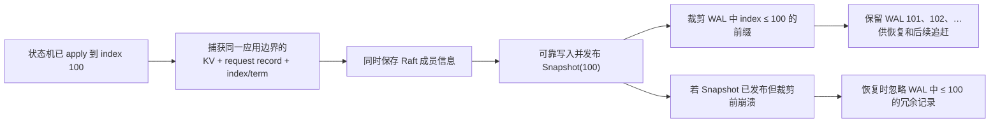
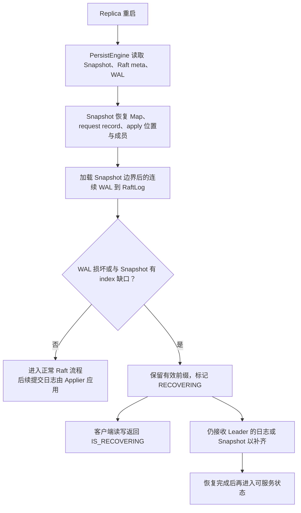
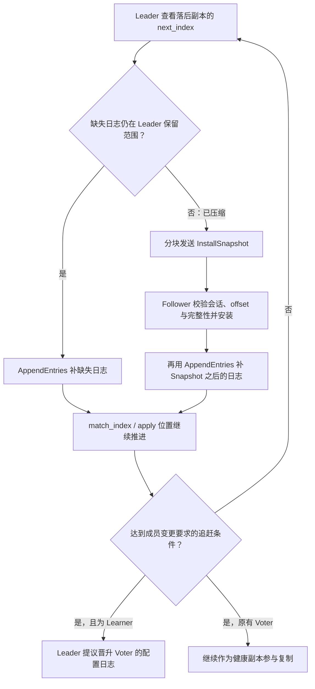

# 05｜持久化与恢复

这三张图把“磁盘里有什么、启动后怎样重建、落后副本怎样补齐”接起来。对照[题库的恢复部分](../分层面试题库.md)练习时，始终指出日志 index 边界。

## 图 17：WAL、Snapshot 与安全裁剪边界

**口述主线**：Snapshot 表示截至某个 apply index 的完整状态，包含 KV、去重记录和成员信息；先可靠保存 Snapshot，再裁剪它覆盖的 WAL 前缀。恢复时用边界去除重复日志，边界后的日志必须连续。

**易错点**：不能先删 WAL 再写 Snapshot，也不能只快照 Map 而丢失 request record。图中 index 100 是示例，不是固定阈值。

**题库**：[53–55、59、61](../分层面试题库.md)；**源码**：[快照捕获](../../../src/storage/replica/replica_snapshot_coordinator.cpp)、[状态机快照](../../../src/storage/raft/state_machine/kv_state_machine.cpp)、[持久化与裁剪](../../../src/storage/persist/persist_engine.cpp)。

## 图 18：Storage 重启后恢复什么

**口述主线**：本地恢复先从 Snapshot 还原状态机，再加载 Raft 元数据和后续 WAL。`recover()` 不应被描述为“所有 WAL 已同步重放到 Map”；后续已提交日志由 Raft/Applier 按安全位置推进。

**易错点**：Map 在内存中运行不代表没有磁盘恢复；发现 WAL 缺口或损坏时不能静默当作数据完整。恢复中的副本拒绝客户端读写，但仍需接收 Raft 内部恢复消息。

**题库**：[56、58、60–61、89](../分层面试题库.md)；**源码**：[PersistEngine::recover](../../../src/storage/persist/persist_engine.cpp)、[Replica::recover](../../../src/storage/replica/replica.cpp)、[恢复状态](../../../src/storage/raft/core/raft_core_recovery.cpp)。

## 图 19：落后副本如何追赶

**口述主线**：优先补仍保留的日志；若落后位置早于 Snapshot 边界，就先安装快照，再追赶快照之后的日志。追赶进度由 `next_index`/`match_index` 等状态反映，Learner 达标后才进入晋升流程。

**易错点**：Snapshot 安装完成只到它的 index，不能直接说“已追到最新”；传输时 Leader 仍可能产生新日志。新副本进程启动也不等于已可计入 quorum。

**题库**：[33、43、57、60、90](../分层面试题库.md)；**源码**：[复制与 Snapshot 选择](../../../src/storage/raft/raft_replication.cpp)、[Snapshot 安装](../../../src/storage/replica/replica_snapshot_coordinator.cpp)、[复制进度](../../../src/storage/raft/raft_peer_progress.cpp)。
